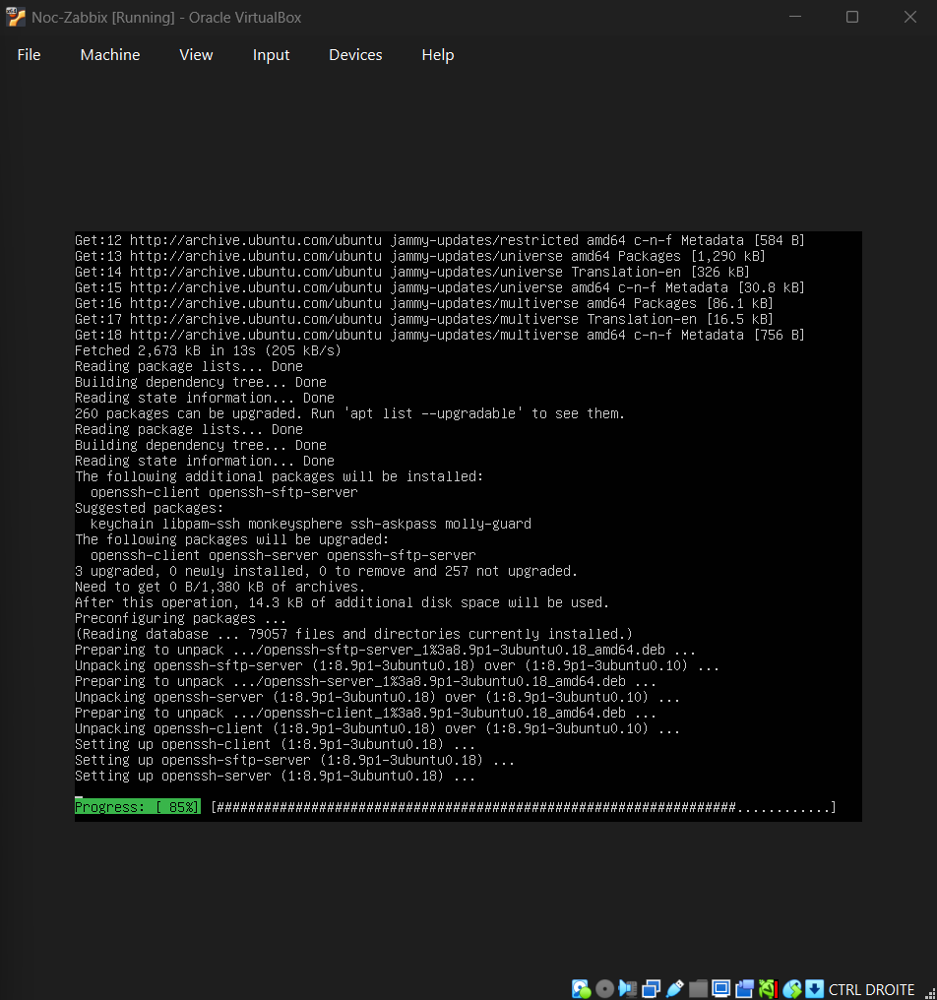
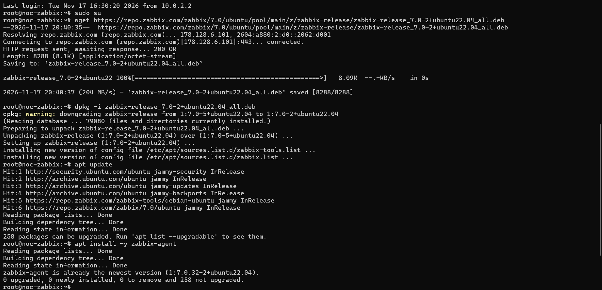
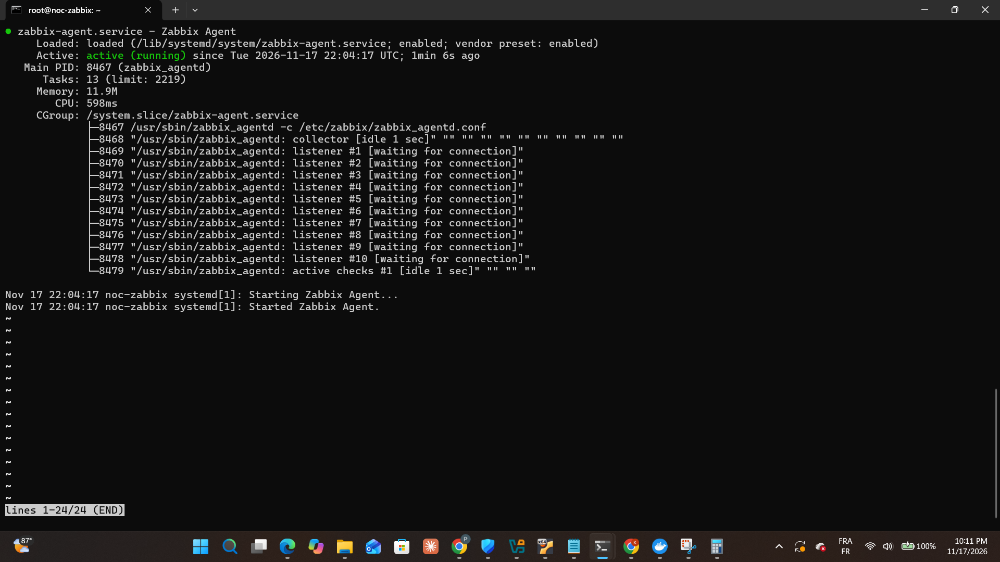
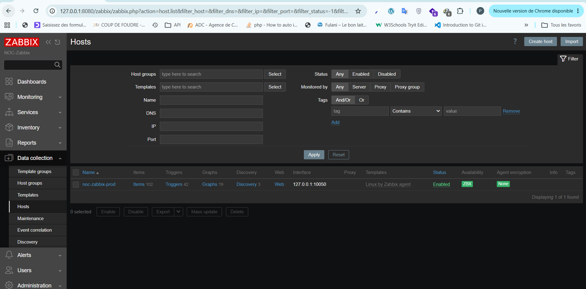
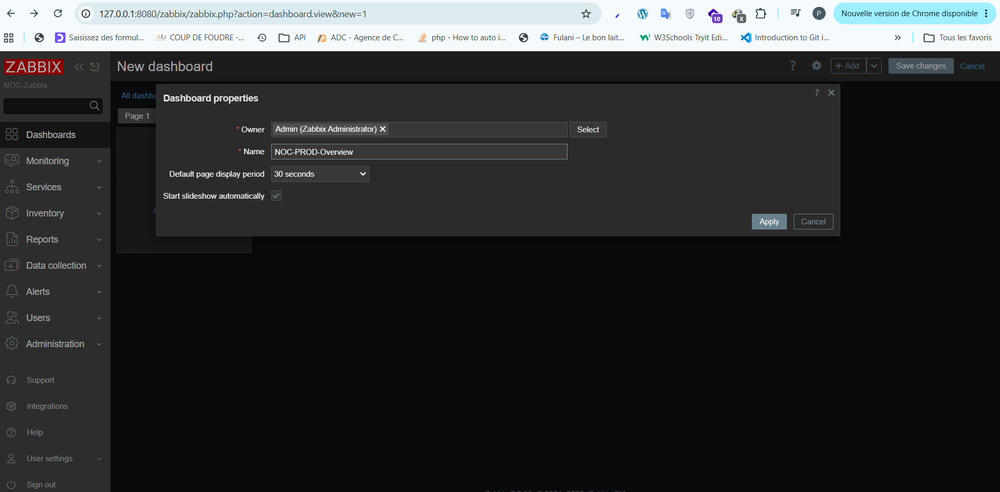
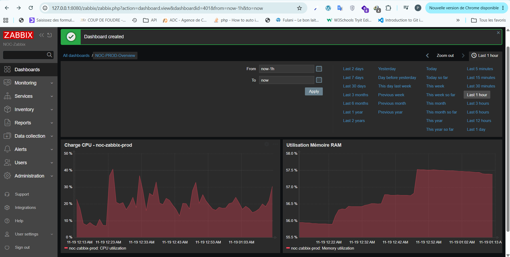
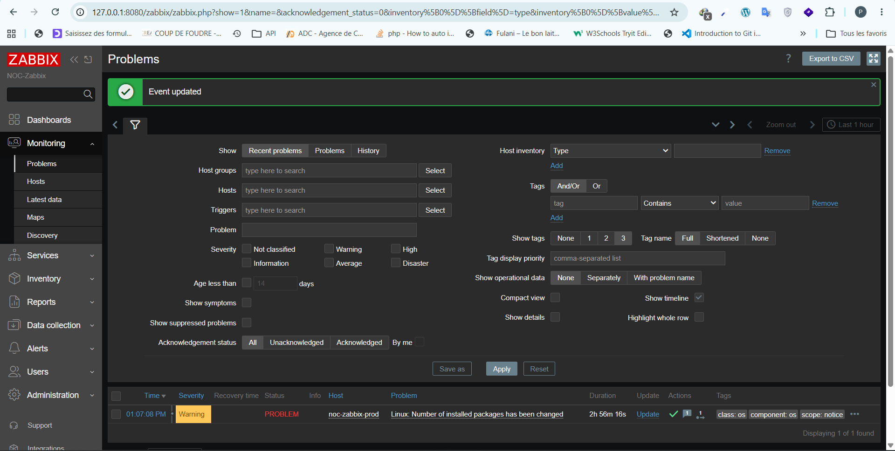
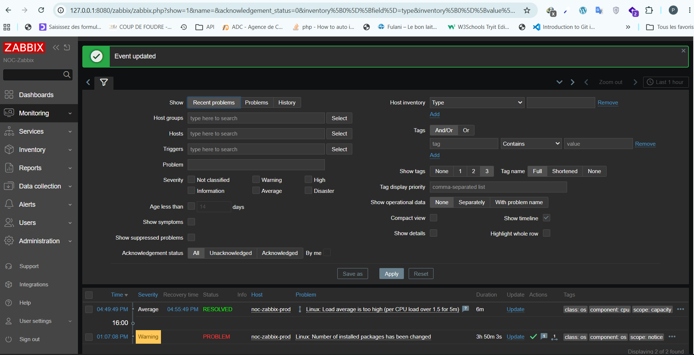

# 📡 Mon Labo NOC : Déploiement Zabbix 7.0 LTS & Gestion du Cycle de Vie d'un Incident

- **Auteur :** Candidat au poste d'Analyste NOC Niveau 1
- **Rôle ciblé :** Analyste NOC N1 / Technicien Supervision & Exploitation Système
- **Environnement :** Ubuntu Server 22.04 LTS (`noc-zabbix-prod`), Zabbix 7.0 LTS, OpenSSH, VirtualBox

---

## 📑 Sommaire
1. [Ma Démarche & Mon Architecture Technique](#-ma-démarche--mon-architecture-technique)
2. [Phases 1 & 2 — Mon Déploiement SSH & Installation de l'Agent Zabbix](#-phases-1--2--mon-déploiement-ssh--installation-de-lagent-zabbix)
3. [Phase 3 — Ma Supervision Temps Réel : Dashboard `NOC-PROD-Overview`](#-phase-3--ma-supervision-temps-réel--dashboard-noc-prod-overview)
4. [Phase 4 — Ma Gestion d'Incident en Conditions Réelles (Standard NOC N1)](#-phase-4--ma-gestion-dincident-en-conditions-réelles-standard-noc-n1)
5. [Mon Playbook d'Incident & Modèle d'Escalade N2](#-mon-playbook-dincident--modèle-descalade-n2)
6. [Ce que ce Labo Démontre de Mes Compétences](#-ce-que-ce-labo-démontre-de-mes-compétences)

---

## 🏗️ Ma Démarche & Mon Architecture Technique

En tant que futur Analyste NOC N1, j'ai conçu ce laboratoire pour simuler fidèlement l'environnement de production d'une entreprise : un serveur critique à superviser 24/7, une chaîne de métrologie proactive avec **Zabbix 7.0 LTS**, et une procédure rigoureuse de traitement d'alertes en ligne de commande.

### Architecture Technique de Mon Labo

| Élément | Valeur dans mon Labo | Justification Opérationnelle |
| :--- | :--- | :--- |
| **Système Cible** | Ubuntu Server 22.04 LTS (*Jammy Jellyfish*) | Distribution stable et standard en production d'entreprise |
| **Nom d'hôte** | `noc-zabbix-prod` | Mon serveur de production supervisé |
| **Plateforme** | Oracle VM VirtualBox | Virtualisation avec redirection de ports d'administration |
| **Adressage / Écoute** | `127.0.0.1` | Boucle locale et flux d'agent sécurisés |
| **Serveur de Supervision** | Zabbix Server 7.0 LTS | Dernière version LTS pour la collecte, les triggers et les dashboards |
| **Agent de Supervision** | Zabbix Agent 7.0 LTS | Service démon `zabbix-agent` en écoute sur `127.0.0.1:10050` |
| **Template Supervisé** | *Linux by Zabbix agent* | Surveillance CPU, RAM, disques, réseau et intégrité système |
| **Accès d'Administration** | OpenSSH Server (`port 22`) | Mon canal sécurisé pour les interventions et diagnostics CLI |

### Schéma des Flux de Mon Infrastructure

```text
+-----------------------------------------------------------------------------------+
|                        Mon Serveur Ubuntu 22.04 LTS                               |
|                             [noc-zabbix-prod]                                     |
|                                                                                   |
|  +------------------------+                     +-------------------------------+  |
|  |     Zabbix Server      |                     |      Zabbix Agent 7.0         |  |
|  |        7.0 LTS         |  Polling TCP:10050  |   (zabbix-agent.service)      |  |
|  |  (Collecte & Triggers) | ------------------> |   Écoute sur 127.0.0.1:10050  |  |
|  +------------------------+                     +-------------------------------+  |
|              ^                                                  |                 |
|              | HTTP/HTTPS                                       v Collecte        |
|  +------------------------+                     +-------------------------------+  |
|  |   Interface Web Zabbix |                     |        Métriques Système      |  |
|  | (Dashboard / Alerting) |                     | (CPU, RAM, Disques, OS, Proc) |  |
|  +------------------------+                     +-------------------------------+  |
|              ^                                                                    |
|              |                                                                    |
+--------------|--------------------------------------------------------------------+
               |
    Session SSH (Port 22) / Web (Port 80/443)
               |
+------------------------------------------------+
|       Mon Poste d'Analyste NOC Niveau 1        |
|  - Surveillance du Dashboard NOC-PROD-Overview |
|  - Acquittement des Alertes (MTTA < 5 min)     |
|  - Diagnostic et Triage en Ligne de Commande   |
+------------------------------------------------+
```

---

## 🚀 Phases 1 & 2 — Mon Déploiement SSH & Installation de l'Agent Zabbix

Pour construire ce labo, j'ai respecté une démarche séquentielle professionnelle : sécuriser d'abord l'accès d'administration, intégrer les dépôts officiels, configurer le service et valider la connectivité.

### 1. Mon Déploiement du Serveur SSH

J'ai installé et activé `openssh-server` pour disposer d'un accès distant sécurisé :

```bash
# Mise à jour des dépôts et installation d'OpenSSH Server
sudo apt update && sudo apt install -y openssh-server

# Activation au démarrage et lancement immédiat
sudo systemctl enable --now ssh

# Contrôle du bon fonctionnement du service
sudo systemctl status ssh
```

J'ai validé que le service SSH était actif et prêt à recevoir mes connexions :



---

### 2. Mon Intégration du Dépôt Officiel Zabbix 7.0 LTS & Installation

J'ai déployé le paquet de configuration du dépôt officiel Zabbix pour bénéficier de la version 7.0 LTS :

```bash
# Téléchargement et installation du package de dépôt officiel
wget https://repo.zabbix.com/zabbix/7.0/ubuntu/pool/main/z/zabbix-release/zabbix-release_latest+ubuntu22.04_all.deb
sudo dpkg -i zabbix-release_latest+ubuntu22.04_all.deb
sudo apt update

# Installation de l'agent Zabbix
sudo apt install -y zabbix-agent
```



---

### 3. Ma Configuration et Démarrage du Service `zabbix-agent`

Dans `/etc/zabbix/zabbix_agentd.conf`, j'ai paramétré les directives indispensables :
- `Server=127.0.0.1` : Autorise les requêtes de collecte de mon serveur Zabbix local.
- `ServerActive=127.0.0.1` : Active les vérifications actives.
- `Hostname=noc-zabbix-prod` : Nom d'hôte strict pour la mise en relation dans Zabbix.

J'ai ensuite activé et démarré le service systemd :

```bash
sudo systemctl enable zabbix-agent
sudo systemctl restart zabbix-agent
sudo systemctl status zabbix-agent
```

J'ai vérifié que le statut de l'agent était bien `active (running)` :



---

### 4. Ma Déclaration de l'Hôte dans Zabbix & Validation de Disponibilité

Dans l'interface web Zabbix (**Data collection > Hosts > Create host**) :
- **Host name :** `noc-zabbix-prod`
- **Templates :** `Linux by Zabbix agent`
- **Host groups :** `Linux servers`
- **Interface :** Type `Agent`, IP `127.0.0.1`, Port `10050`.

Après la première interrogation, le témoin de disponibilité **ZBX est passé au vert**, validant la réussite de mon intégration :



---

## 📊 Phase 3 — Ma Supervision Temps Réel : Dashboard `NOC-PROD-Overview`

Pour piloter l'infrastructure comme en conditions réelles de salle de contrôle NOC, j'ai conçu un tableau de bord dédié : **`NOC-PROD-Overview`**.

### Les Widgets que J'ai Configurés :
1. **Host Availability :** Vue immédiate sur l'état de joignabilité de `noc-zabbix-prod`.
2. **Current Problems :** Liste filtrée des alertes en cours triées par sévérité.
3. **Graphique Métrique — Charge CPU (`noc-zabbix-prod`) :**
   - Utilisation CPU en direct (`system.cpu.util`).
   - Load average à 1 min, 5 min et 15 min (`system.cpu.load[all,avg1/5/15]`).
4. **Graphique Métrique — Utilisation Mémoire RAM :**
   - Mémoire totale, utilisée et disponible (`vm.memory.size`).
   - Pourcentage d'occupation de la mémoire vive (`vm.memory.util`).

### L'Évolution de Mon Dashboard :

- La structure initiale que j'ai configurée :



- Mon dashboard final en fonctionnement opérationnel avec flux de données temps réel :



---

## 🚨 Phase 4 — Ma Gestion d'Incident en Conditions Réelles (Standard NOC N1)

Cette phase illustre ma capacité à gérer le cycle de vie complet d'un incident de production, de la détection jusqu'à la résolution.

### 1. Ma Détection des Alertes

Dans la console Zabbix, j'ai constaté le déclenchement de deux alertes consécutives :
1. **Alerte Haute :** `Linux: Load average is too high` (seuil de charge CPU dépassé).
2. **Alerte Informationnelle :** `Linux: Number of installed packages has been changed` (alerte d'intégrité liée aux installations de paquets).

---

### 2. Mon Acquittement Documenté (Acknowledge)

Conformément à ma rigueur d'Analyste NOC N1, je n'ai pas laissé l'alerte sans réponse. J'ai effectué un **acquittement immédiat** pour notifier l'équipe :

- **Action :** Clic sur le trigger > `Acknowledge`.
- **Mon commentaire consigné dans Zabbix :**
  > *"Incident pris en compte par l'analyste NOC N1. Début des investigations CLI en SSH sur l'hôte noc-zabbix-prod pour analyse de la charge processeur et des logs système."*
- **Résultat :** L'alerte est marquée comme acquittée (`Acknowledged: Yes`), garantissant la traçabilité de ma prise en charge.



---

### 3. Mon Diagnostic Opérationnel en CLI via SSH

J'ai immédiatement ouvert une session SSH sur le serveur `noc-zabbix-prod` et déroulé ma chaîne de commandes de triage :

```bash
# 1. Je valide la connectivité réseau locale
ping -c 4 127.0.0.1

# 2. Je contrôle que le port de l'agent Zabbix (10050) écoute correctement
nc -zv 127.0.0.1 10050
ss -tulpn | grep 10050

# 3. J'identifie les processus qui monopolisent le CPU
ps aux --sort=-%cpu | head -n 10
top -b -n 1 | head -n 20

# 4. Je vérifie l'état de la mémoire et des disques
free -h
df -h

# 5. J'inspecte les logs de l'agent Zabbix et du système
sudo journalctl -u zabbix-agent -n 50 --no-pager
sudo tail -n 50 /var/log/zabbix/zabbix_agentd.log
```

**Mes conclusions d'investigation :**
- Le pic de charge était dû aux opérations intensives de compilation et d'installation des paquets du labo.
- Aucun processus malveillant ou zombie n'a été détecté.
- La connectivité de l'agent Zabbix est restée stable à 100%.

---

### 4. Le Rétablissement & Mon Suivi jusqu'au Statut `RESOLVED`

- Une fois l'opération terminée, la charge processeur est revenue sous le seuil d'alerte.
- Zabbix a automatiquement basculé le problème à l'état **RESOLVED**.
- J'ai validé la stabilité de la métrique sur mon dashboard `NOC-PROD-Overview` avant de clôturer mon suivi.



---

## 📖 Mon Playbook d'Incident & Modèle d'Escalade N2

J'ai formalisé toute ma démarche de diagnostic dans un document de référence :

👉 **[Consulter Mon Playbook d'Incident NOC Niveau 1](./docs/noc-incident-playbook.md)**

Vous y trouverez :
- Ma méthode réflexe en 5 étapes (Acquittement → Réseau → Ports/Services → SSH & Logs → Clôture/Escalade).
- Mon modèle de ticket d'escalade N2 entièrement renseigné à partir de mon incident réel sur `noc-zabbix-prod`.

---

## 🏆 Ce que ce Labo Démontre de Mes Compétences

| Domaine | Ce que j'ai réalisé et maîtrisé dans ce labo |
| :--- | :--- |
| **Supervision Zabbix 7.0 LTS** | Déploiement complet, configuration des fichiers `.conf`, liaison de templates officiels, création de dashboards multi-métriques. |
| **Poste d'Analyste NOC N1** | Réflexe d'acquittement immédiat (MTTA), respect des standards d'exploitation, documentation continue des actions menées. |
| **Administration Système Linux** | Démons `systemd`, OpenSSH, diagnostic réseau en ligne de commande (`nc`, `ss`, `ping`), analyse de processus (`ps`, `top`) et de journaux (`journalctl`). |
| **Gestion des Incidents & ITIL** | Respect du cycle complet de l'incident : détection, qualification, investigation, communication, résolution ou escalade N2 formalisée. |

---
*Projet conçu, déployé et documenté par mes soins dans le cadre de ma candidature au poste d'Analyste NOC Niveau 1.*
